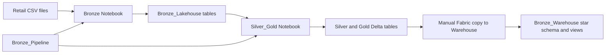

# Retail sales analytics on Microsoft Fabric

This repository contains a small end-to-end retail analytics example using a
Fabric Lakehouse, PySpark notebooks, a Fabric Data Pipeline, and a Warehouse
star schema. The CSV data is synthetic and documented in
[`data/retail-sales/README.md`](data/retail-sales/README.md).

## Architecture



`Bronze_Pipeline` runs the two notebooks in order: `BronzeIngestion` writes or
upserts Bronze Delta tables, then `SilverGoldTransformation` runs only after
the first activity succeeds. Both notebooks expect `Bronze_Lakehouse` to be
attached as their default Lakehouse. The pipeline does not load the Warehouse;
loading the Gold tables into `Bronze_Warehouse` is a separate deployment step.

The Silver/Gold notebook writes cleaned `silver_*` snapshots, rejected rows,
and Type 1 Gold dimensions and `fact_sales` to the Lakehouse. The Warehouse
scripts define the matching star schema and five reporting views. The
Warehouse is named `Bronze_Warehouse` in this sample, though its retail
analytics tables are modeled from Gold data.

## Repository map

| Path | Purpose |
| --- | --- |
| `data/retail-sales/` | Synthetic CSV inputs and their source schema. |
| `Bronze_Lakehouse.Lakehouse/` | Fabric Lakehouse item metadata. |
| `Bronze_Notebook.Notebook/` | CSV ingestion, Bronze validation, and upsert logic. |
| `Silver_Gold_Notebook.Notebook/` | Silver cleaning/quarantine and Gold star-schema transforms. |
| `Bronze_Pipeline.DataPipeline/` | Notebook orchestration definition. |
| `Bronze_Warehouse.Warehouse/scripts/` | Ordered Warehouse table, constraint, view, and validation SQL. |
| `tests/` | Local PySpark unit and data-quality tests for notebook functions. |
| `TROUBLESHOOTING.md` | Common setup, pipeline, data quality, and local-test failures. |
| `REVIEW_FINDINGS.md` | Existing implementation observations and recommendations, kept separate. |

## Dependencies

### Fabric runtime

- A Fabric workspace with the repository's Lakehouse, notebooks, pipeline, and
  Warehouse items deployed.
- Fabric's notebook Spark runtime provides PySpark and Delta Lake; no external
  Python package is required by the notebook code.
- The CSVs must be copied to the attached Lakehouse's
  `Files/retail-sales/` folder. A repository checkout path is not a Spark file
  path.

### Local tests and SQL project

- Python and Java are required for local PySpark tests. Install a PySpark
  version compatible with the Fabric Spark runtime:

  ```sh
  python -m pip install -r requirements-test.txt
  python -m unittest discover -s tests -v
  ```

- The Warehouse SQL project uses the `Microsoft.Build.Sql` SDK and Fabric
  Warehouse Dacpac package declared in
  `Bronze_Warehouse.Warehouse/Bronze_Warehouse.sqlproj`.

## Run and deploy

1. Deploy or connect the Fabric items in a workspace. Verify the pipeline's
   notebook/workspace bindings and attach `Bronze_Lakehouse` as the default
   Lakehouse for both notebooks.
2. Upload `data/retail-sales/*.csv` to `Bronze_Lakehouse/Files/retail-sales/`.
3. In `Bronze_Warehouse`, run the SQL files in this order:
   `scripts/01_dimensions.sql`, `scripts/02_fact_sales.sql`, then each file in
   `scripts/03_views/`. Use the Warehouse SQL query editor; the deployment
   scripts are intentionally excluded from the SQL project's DACPAC model
   build.
4. Run `Bronze_Pipeline`. It executes Bronze ingestion before Silver/Gold
   transformation. `processing_date` and `environment` are currently logged
   as run context; they do not filter data or select a workspace.
5. Copy the Gold tables `dim_customer`, `dim_product`, `dim_store`, `dim_date`,
   and `fact_sales` from the Lakehouse into the matching Warehouse tables with
   a Fabric pipeline copy activity or Dataflow Gen2. Preserve the generated
   surrogate keys and refresh snapshots rather than appending repeated full
   snapshots.
6. Run `Bronze_Warehouse.Warehouse/scripts/04_validate_model.sql`. Resolve
   returned rows before using the views. Fabric Warehouse PK/FK/UNIQUE
   constraints are `NOT ENFORCED`, so they do not replace these data checks.

See the [Warehouse data dictionary and deployment notes](Bronze_Warehouse.Warehouse/README.md)
for table grains, columns, key formats, and view definitions. The Fabric
Warehouse was not accessed or changed while preparing this repository work.
