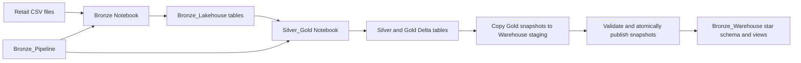

# Retail sales analytics on Microsoft Fabric

This repository contains a small end-to-end retail analytics example using a
Fabric Lakehouse, PySpark notebooks, a Fabric Data Pipeline, and a Warehouse
star schema. The CSV data is synthetic and documented in
[`data/retail-sales/README.md`](data/retail-sales/README.md).

## Architecture



`Bronze_Pipeline` runs the two notebooks in order: `BronzeIngestion` writes or
upserts Bronze Delta tables, then `SilverGoldTransformation` runs only after
the first activity succeeds. Both notebooks expect `Bronze_Lakehouse` to be
attached as their default Lakehouse. The checked-in pipeline runs both
notebooks, then copies the five Gold tables into Warehouse staging. The Copy
activities read Lakehouse managed tables and truncate only their matching
staging table before loading. Publishing and validation remain manual Warehouse
SQL steps:
`scripts/06_publish_snapshot.sql`, followed by
`scripts/04_validate_model.sql`.
The item IDs and linked-service bindings come from the existing live pipeline
definition. This repository change does not update or run the live Fabric
pipeline. The activity graph is validated locally. A Warehouse connection
suitable for a Fabric Script activity is not established by the current
pipeline definition, so no Script activities are included.

The Silver/Gold notebook writes cleaned `silver_*` snapshots, rejected rows,
and Type 1 Gold dimensions and `fact_sales` to the Lakehouse. The Warehouse
scripts define the matching star schema and five reporting views. The
Warehouse is named `Bronze_Warehouse` in this sample, though its retail
analytics tables are modeled from Gold data.

## Repository map

| Path | Purpose |
| --- | --- |
| `data/retail-sales/` | Synthetic CSV inputs and their source schema. |
| `Bronze_Lakehouse.Lakehouse/` | Fabric Lakehouse item metadata. |
| `Bronze_Notebook.Notebook/` | CSV ingestion, Bronze validation, and upsert logic. |
| `Silver_Gold_Notebook.Notebook/` | Silver cleaning/quarantine and Gold star-schema transforms. |
| `Bronze_Pipeline.DataPipeline/` | Notebook orchestration definition. |
| `Bronze_Warehouse.Warehouse/scripts/` | Ordered Warehouse table, constraint, view, and validation SQL. |
| `tests/` | Local PySpark unit and data-quality tests for notebook functions. |
| `TROUBLESHOOTING.md` | Common setup, pipeline, data quality, and local-test failures. |
| `REVIEW_FINDINGS.md` | Existing implementation observations and recommendations, kept separate. |

## Dependencies

### Fabric deployment CLI

The reusable `fabric-deployer` package retrieves Fabric item definitions,
validates and edits JSON parts, and can submit a complete definition with
concurrency checks and asynchronous operation polling. It preserves all
untouched definition parts. A dry-run is the default; deployment requires the
explicit `--apply` flag.

Install the CLI and its dependencies with:

```sh
python3 -m pip install .
```

The CLI uses Microsoft Entra authentication through Azure Identity's
`DefaultAzureCredential` chain. It checks supported credentials in sequence
(environment service principal, workload identity, managed identity, VS Code,
Azure CLI, Azure PowerShell, Azure Developer CLI, and brokered auth where
supported) and uses the first one that can provide a token. On macOS, the
recommended developer flow is Azure CLI:

1. Install Python 3.10+ and the Azure CLI. With Homebrew:

   ```sh
   brew install azure-cli
   python3 -m pip install .
   ```
2. Sign in to the tenant that contains the Fabric workspace:

   ```sh
   az login --tenant <tenant-id>
   az account show --query tenantId --output tsv
   ```
3. Ensure the signed-in user has read/write permission to the item and that
   the tenant/app permissions allow the Fabric `Item.ReadWrite.All` delegated
   scope required by [Get Item Definition](https://learn.microsoft.com/en-us/rest/api/fabric/core/items/get-item-definition).
   Although the API requires those permissions, the check below only retrieves
   the definition; it does not update or execute the pipeline.
4. Run the explicitly opt-in live authentication check:

   ```sh
   FABRIC_DEPLOYER_LIVE_READ=1 python3 -m unittest tests.test_fabric_auth_live -v
   ```

   This acquires a Fabric-scoped token through `DefaultAzureCredential`, calls
   the API's `POST .../getDefinition` read operation for the configured
   workspace and item, validates the returned definition, and never prints or
   stores the token or definition payload. The workspace/item IDs default to
   the `Bronze_Pipeline` example values; set
   `FABRIC_DEPLOYER_WORKSPACE_ID` and `FABRIC_DEPLOYER_ITEM_ID` to override
   them. Without the opt-in environment variable, the live test is skipped.

Access tokens and complete item-definition payloads are never printed or
logged. The live check is separate from deployment and contains no write or
pipeline-execution call.

The example configuration is [examples/fabric-deployer.json](examples/fabric-deployer.json).
It targets `Bronze_Pipeline` and proposes a JSON change, but does not deploy:

```sh
fabric-deployer --config examples/fabric-deployer.json
fabric-deployer --config examples/fabric-deployer.json --expected-fingerprint <sha256>
```

Both commands only retrieve the definition and print fingerprints and a
change/verification summary. `--expected-fingerprint` aborts if the live
definition has changed. Only use `--apply` when a live update has been
explicitly approved:

```sh
fabric-deployer --config examples/fabric-deployer.json --apply
```

The utility rereads the live definition immediately before submission and
verifies the final definition after completion. If a submission has an
ambiguous outcome, it checks the live definition and never retries the write
automatically. Fabric's update API does not provide an atomic compare-and-swap
through this client, so the fingerprint check narrows but cannot eliminate the
race between the final read and update request. Unit tests use a fake client
and do not modify Fabric items.

### Fabric runtime

- A Fabric workspace with the repository's Lakehouse, notebooks, pipeline, and
  Warehouse items deployed.
- Fabric's notebook Spark runtime provides PySpark and Delta Lake; no external
  Python package is required by the notebook code.
- The CSVs must be copied to the attached Lakehouse's
  `Files/retail-sales/` folder. A repository checkout path is not a Spark file
  path.

### Local tests and SQL project

- Python and Java are required for local PySpark tests. Install a PySpark
  version compatible with the Fabric Spark runtime:

  ```sh
  python -m pip install -r requirements-test.txt
  python -m unittest discover -s tests -v
  ```

- The Warehouse SQL project uses the `Microsoft.Build.Sql` SDK and Fabric
  Warehouse Dacpac package declared in
  `Bronze_Warehouse.Warehouse/Bronze_Warehouse.sqlproj`.

## Run and deploy

1. Deploy or connect the Fabric items in a workspace. Verify the pipeline's
   notebook/workspace bindings and attach `Bronze_Lakehouse` as the default
   Lakehouse for both notebooks.
2. Upload `data/retail-sales/*.csv` to `Bronze_Lakehouse/Files/retail-sales/`.
3. In `Bronze_Warehouse`, run the SQL files in this order:
   `scripts/01_dimensions.sql`, `scripts/02_fact_sales.sql`, then each file in
   `scripts/03_views/`, and `scripts/05_create_snapshot_staging.sql`. Use the
   Warehouse SQL query editor; deployment scripts are excluded from the SQL
   project's DACPAC model build.
4. Run `Bronze_Pipeline`. It executes Bronze ingestion, Silver/Gold
   transformation, then five Gold-to-staging copies. `processing_date` and
   `environment` are logged as run context; they do not filter data or select
   a workspace.
5. After all five copies succeed, run
   `Bronze_Warehouse.Warehouse/scripts/06_publish_snapshot.sql` in the
   Warehouse SQL query editor, followed by
   `Bronze_Warehouse.Warehouse/scripts/04_validate_model.sql`. Resolve any
   returned rows before using the views. Fabric Warehouse PK/FK/UNIQUE
   constraints are `NOT ENFORCED`, so they do not replace these data checks.

See the [Warehouse data dictionary and deployment notes](Bronze_Warehouse.Warehouse/README.md)
for table grains, columns, key formats, and view definitions. The Fabric
pipeline definition was inspected read-only; no live Fabric items were
changed.
